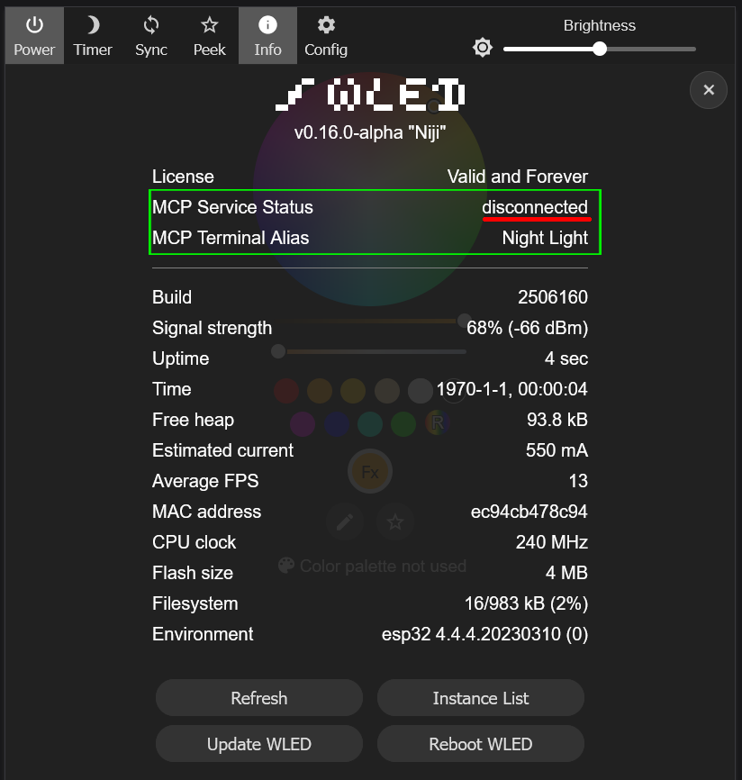
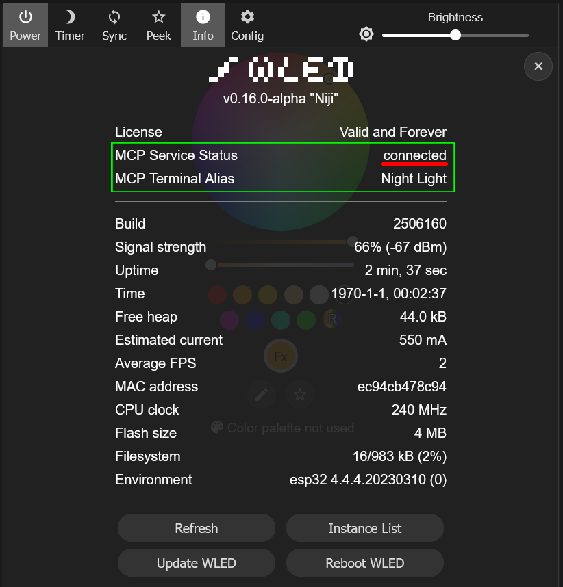
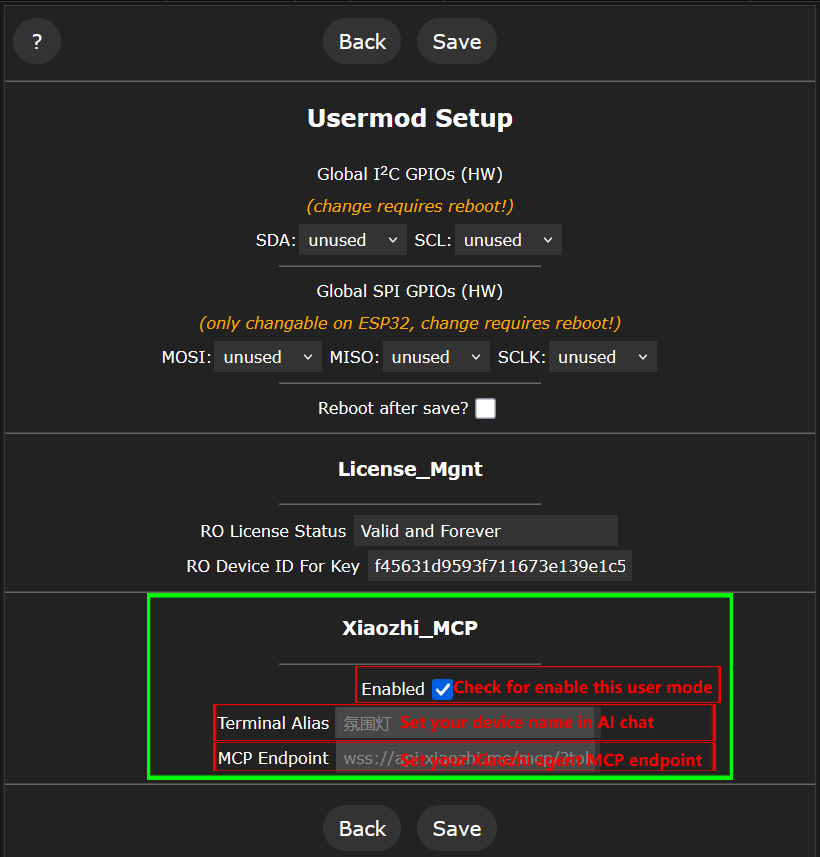
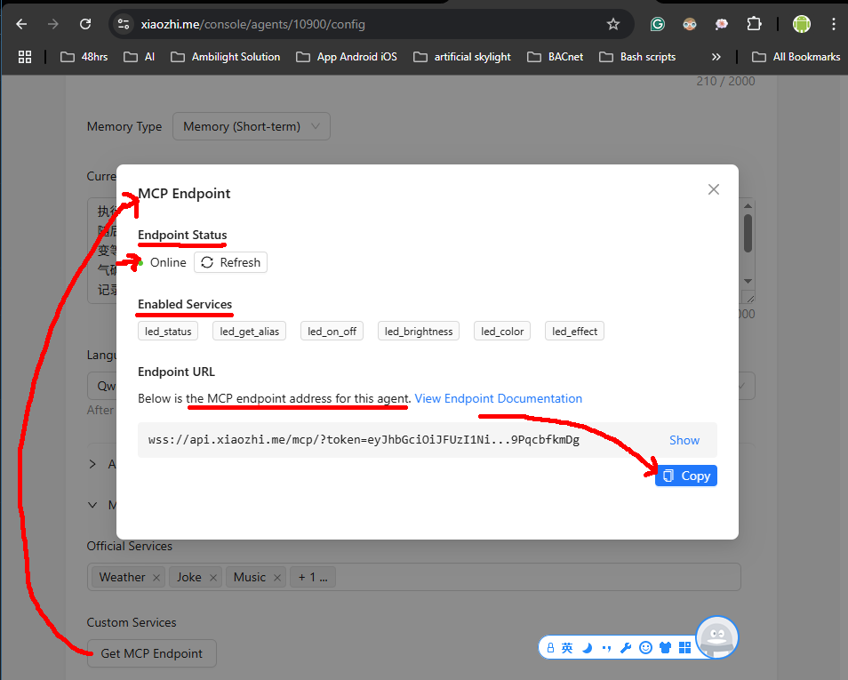
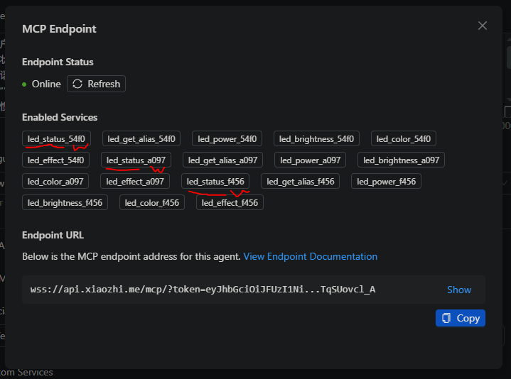

# Xiaozhi_MCP Usermod

# Note

This user mode leverages the xiaozhi-esp32-mcp as backend service to establish the connection/bidirectional communication to xiaozhi.me with the following adjustments:

* Use the xiaozhi_mcp-1.0.0.zip fetched from the https://www.arduinolibraries.info/libraries/xiaozhi-mcp and only keep the WebSocketMCP.h and WebSocketMCP.cpp files at minimal for Xiaozhi_MCP user mode.
* Use the wled.h header instead of the ones in the original header list (the wled project has built-in ArduinoJson.h).
* Translate the Chinese into English in the Serial.println function in this WebSocketMCP.cpp file and removed the blank line.

Copy all the content in the section `RO Device ID For Key` in License_Mgnt and send it to the vendor for key generation and service authorization. Without the device key, it will have a 60-minute FREE trial. 

Go to your device host ip + `/edit` (e.g. http://192.168.71.24/edit) in browser and import the key file naming `DEVICE_KEY`.

## Features
 - ✨ Adds the Xiaozhi AI platform connection status and MCP alias to the `Info` tab
 - ✨ Allows end user to enable/disable the Xiaozhi_MCP user mode (disabled as default), set MCP alias and endpoint in `settings`->`usermode` tab
 - ✨ Supports Xiaozhi AI agent to control multiple WLED instances built-in with Xiaozhi_MCP user mode via the customized MCP alias

## Use Examples
- Populate the Xiaozhi AI Agent MCP Endpoint (and alias) in usermod settings page
- This user mode will not run if MCP Endpoint (and alias) is not populated

## Compatibility
- ESP32 supports this user mode while ESP8266 does not support
- MCP tools (get the current status, power on/off, control brightness, set the color, set the effect and more - todo)
- The supplied ESP32 build override disables Alexa voice control to fit the firmware in the 4 MB OTA app slot; GIF and IR support remain enabled.

### ESP-IDF 5 transport

`WebSocketMCP` uses ESP-IDF WebSocket framing with Arduino `NetworkClient` for
TCP and [ESP_SSLClient 3.1.3](https://github.com/mobizt/ESP_SSLClient/tree/v3.1.3)
(BearSSL) for TLS. This keeps the Tasmota `esp32_idf_V5` platform: its SDK does
not supply the complete mbedTLS implementation required by native ESP-IDF TLS.
Replace `links2004/WebSockets` in custom `lib_deps` with
`mobizt/ESP_SSLClient @ 3.1.3`, as shown in the supplied overrides. No changes to
main `platformio.ini` are needed. The trust-store adapter targets the IDF 5.5
certificate-bundle format used by the current Tasmota SDK.

ESPAsyncWebServerWLED remains WLED's HTTP/WebSocket **server**. Its
`AsyncWebSocketClient` represents an incoming connection and cannot initiate the
outbound connection required by Xiaozhi. It is therefore not the MCP transport.

The six tools, device ID suffixes, alias descriptions, initialization response,
and JSON-RPC handlers are retained. Networking runs in a worker; tool callbacks
and connection notifications run from the main WLED loop. Disabling the usermod
stops the worker. Lifecycle/send/tool APIs belong to the main loop task; callbacks
may stop or replace the connection. A replacement waits for the retiring worker
to stop its I/O before allocating another task/TLS session. Disconnected queues
are drained promptly, including late replies, rather than held during backoff.
Network failure or `disconnect()` schedules another attempt
after 60 seconds. The previous exponential-backoff code only logged attempts;
the actual library reconnect interval was 60 seconds.

WebSocket ping and pong timeouts remain 10 seconds, with six missed pongs causing
a reconnect. The application-level timeout remains 120 seconds after a JSON-RPC
ping. Text messages can now span multiple frames. Incoming and outgoing messages
are limited to 15 KiB each, with four entries per queue. Queue exhaustion or a
transport failure closes the connection; stale requests and responses are not
replayed after reconnect. `sendMessage()` reports queue acceptance, not delivery.

**TLS behavior change:** `wss://` verifies the server certificate using the
SDK's CA bundle through BearSSL's static trust anchors. ESP_SSLClient 3.1.3's
bundled verifier does not invoke its advertised dynamic lookup callbacks.
Compact anchor descriptors live in RAM during a connection; root subjects and
public keys remain in flash. Descriptors are freed after TLS stops. Enable WLED's time
synchronization in **Time & Macros** and ensure the clock is correct. The main
loop publishes WLED's UTC time to the networking worker; WLED's clock is separate
from the ESP32 POSIX clock. While time is unset, MCP waits without starting TLS
and shows the reason in **MCP Connection Detail** in the Info panel. It resumes
automatically when time becomes available. Self-signed certificates are not accepted by the default bundle. There
is no automatic fallback to plaintext or unverified TLS. `ws://` remains available
for existing local endpoints. Endpoint URLs are not written to usermod logs.
TLS is explicitly requested on every `wss://` port, including custom ports.
BearSSL supports TLS 1.2; endpoints requiring TLS 1.3 alone cannot connect.
Secure endpoint hostnames are limited to 63 characters by this library version.
The worker has an 8 KiB stack, a 16 KiB TLS receive buffer, a 512-byte TLS send
buffer, and additional TLS/queue/message allocations. Check free heap under
real LED/network load, especially on ESP32 boards without PSRAM.

The HTTP upgrade is read without consuming bytes from the first WebSocket frame;
the ESP-IDF WebSocket transport handles framing and client masking. References:
[ESP-IDF TCP transport](https://github.com/espressif/esp-idf/tree/v5.5.4/components/tcp_transport)
and [RFC 6455](https://www.rfc-editor.org/rfc/rfc6455).

For an on-device protocol smoke test, run
`node tools/xiaozhi-mcp-smoke.js` on a machine reachable by the ESP32, then set the
MCP endpoint to `ws://<that-machine-IP>:8765/mcp` and reboot the ESP32. The test
checks initialization, tool listing, status queries, fragmented messages, and
WebSocket ping/pong without changing LED settings. It does not test TLS or network
recovery by default. Set `MCP_TEST_CYCLES=3` to repeat the protocol checks across
three connections, forcibly dropping TCP between them and checking the roughly
60-second reconnect delay. Also verify a real `wss://` endpoint, Wi-Fi/Ethernet reconnection,
disable/re-enable, and heap stability on the target board before deployment.

### Existing MCP serialization limits

The transport replacement retains the existing JSON-RPC handlers. Those handlers
still assume numeric request IDs, interpolate tool descriptions without JSON
escaping, and use a 1 KiB request JSON document. String IDs or aliases containing
quotes/backslashes can therefore produce incorrect responses, and a message
within the transport's 15 KiB limit can still exceed the JSON parser's capacity.
These are separate MCP-layer issues, not guarantees provided by the transport.

## Installation
- Add `Xiaozhi_MCP` to `custom_usermods` in your `platformio.ini` (or `platformio_override.ini`).

## 📝 Change Log

2026-01-18

- "Xiaozhi_MCP" usermod initial release with primary functions.

2025-12-31

- Documentation updated

2025-12-26

* "Xiaozhi_MCP" usermod created

## Authors
- M-Tech [@betamoojw](https://github.com/betamoojw)
